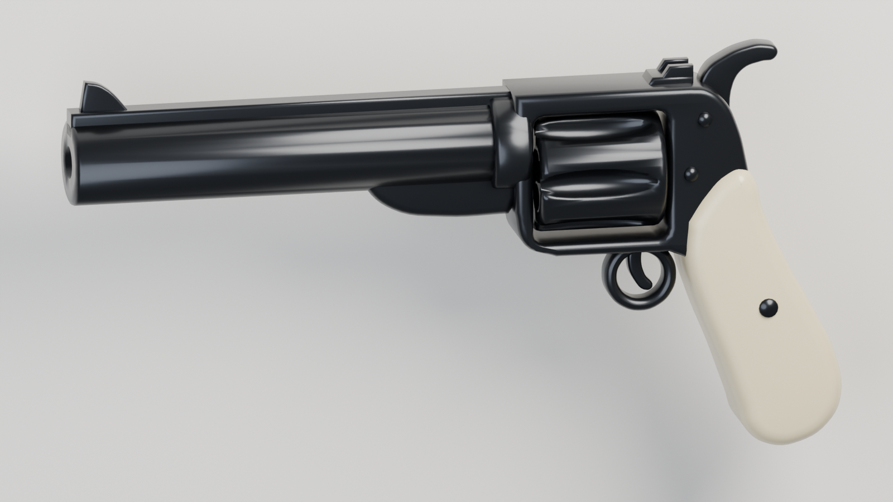

# Long-barrel revolver model

`assets/revolver.blend` contains a stylized long-barrel revolver with a blued steel
body and an ivory grip, modeled after the reference concept art. It has a fluted
six-shot cylinder, a top rib with front and rear sights, an ejector shroud, a curled
hammer spur, a round trigger guard, and a flared grip with medallions.



## Blender scene

- `01_Revolver_Parts`: the editable source. Most parts are 2D curve profiles
  (side view, extruded with rounded bevels). The barrel and cylinder are meshes with
  live bevel and boolean modifiers. The bore, chambers, and flutes are cut by
  objects in `80_Boolean_Cutters`, which are hidden.
- `02_Roblox_Export`: the evaluated parts, joined into one triangulated mesh per
  material. This collection is hidden in the viewport but used for the render.
- `90_Render_Studio`: camera, lights, and backdrop for `revolver-preview.png`.

Units are studs: 1 Blender unit is 1 stud. The barrel points along Blender -Y.

## Files

- `revolver.fbx`: `Revolver_Steel` (11.6k triangles) and `Revolver_Grip` (1.8k
  triangles) for Roblox Studio's 3D Importer.
- `revolver.glb`: the same two meshes with their materials.
- `revolver-preview.png`: studio render of the exported meshes.
- `revolver-attachments.json`: size, triangle counts, and the grip and muzzle
  positions relative to each MeshPart's center. It is regenerated on every build.

## Import into Roblox

1. In Studio, use **Import 3D** with `revolver.fbx`. Set **File Dimensions** to
   **Studs**. The model should be about 0.34 × 1.17 × 2.23 studs, with the barrel
   along -Z and up along +Y.
2. Keep the MeshPart names `Revolver_Grip` and `Revolver_Steel`, then upload the
   model. The FBX import is model `112277398227118`. The GLB import, `92014581190238`,
   is unused.
3. The game loads the model at server start (`src/server/RevolverModel.luau`). It
   finds the barrel direction from the steel mesh's longest side and its offset from
   the grip, so it doesn't depend on how the importer oriented the meshes. It sets
   colors (steel `#24272C` Metal, grip `#D9CCA6` SmoothPlastic) and collision flags
   in code. After re-importing, update `MODEL_ID` in that module.

`revolver-attachments.json` gives the same offsets as reference values. Roblox centers
each MeshPart on its bounding box, so these are measured from the MeshParts' bounding-box
centers, not from the Blender origin.

## Rebuild

From the repository root in PowerShell:

```powershell
& 'C:/Program Files/Blender Foundation/Blender 5.2/blender.exe' --background assets/revolver.blend --python-exit-code 1 --python tools/build_revolver.py
```

The builder regenerates all of its collections from `tools/build_revolver.py`, then
rewrites the blend file, the exports, the attachment JSON, and the preview render.
To make a lasting shape change, edit the profile coordinates in the script. Manual
edits in the blend are lost on rebuild.
